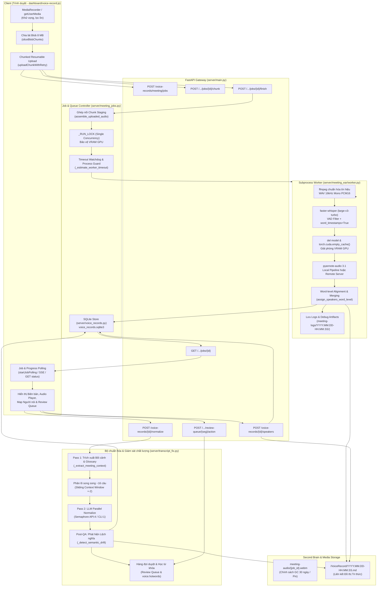
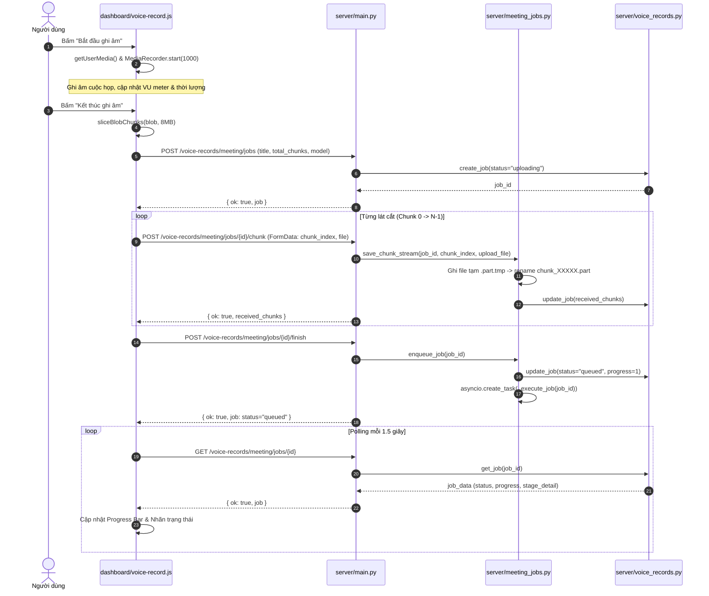
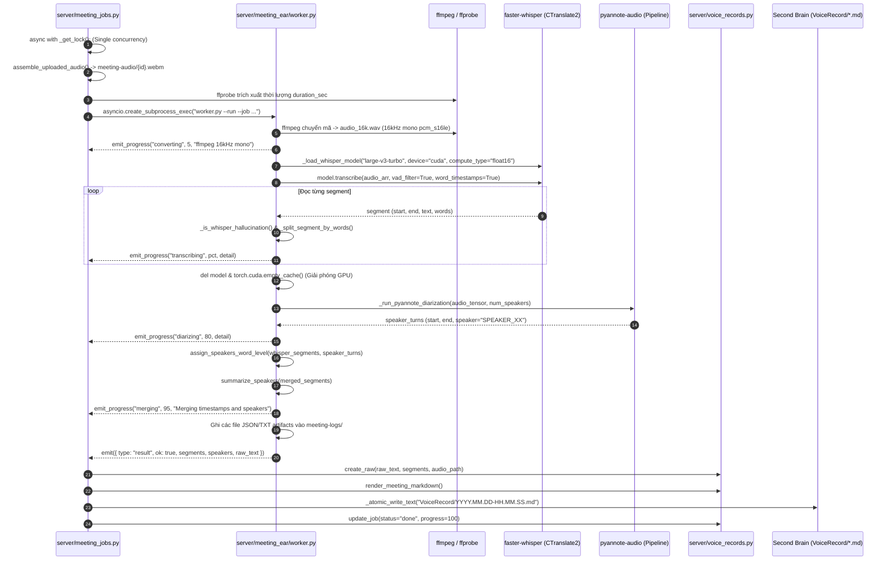
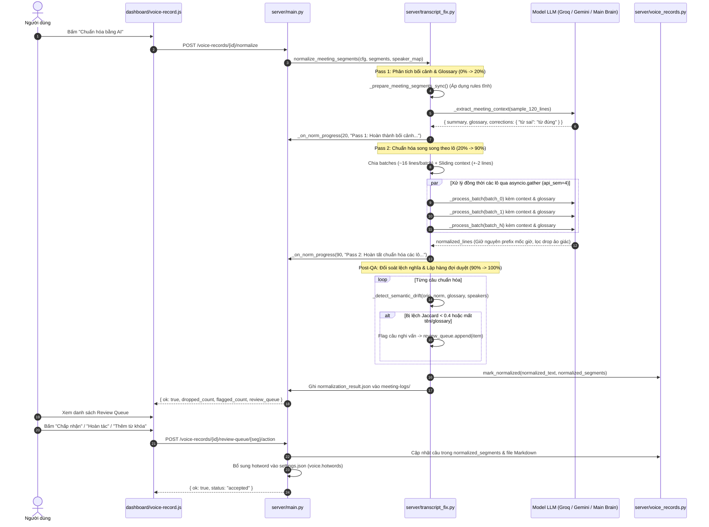

# Khảo sát chi tiết luồng nghiệp vụ: Ghi âm cuộc họp sang văn bản (Meeting Audio-to-Transcript Pipeline)

Tài liệu này khảo sát và phân tích toàn diện luồng nghiệp vụ chuyển hóa âm thanh cuộc họp thành biên bản văn bản hoàn chỉnh trong JAVIS OS. Chu trình bao gồm 5 giai đoạn cốt lõi: **Thu âm / Tải lên chia lát** -> **Chuẩn hóa tín hiệu & Chuyển đổi STT (Speech-to-Text)** -> **Phân tách người nói (Speaker Diarization)** -> **Ghép nối từ với người nói (Word-level Alignment & Merge)** -> **Chuẩn hóa văn bản với LLM 2-Pass & Kiểm soát chất lượng (QA / Semantic Drift)**.

---

## 1. Tổng quan kiến trúc & Luồng nghiệp vụ End-to-End

### 1.1. Mục tiêu và bối cảnh nghiệp vụ
Các cuộc họp doanh nghiệp thường kéo dài từ 30 phút đến vài giờ, bao gồm nhiều người tham gia, có hiện tượng nói đè (overlap), sử dụng xen kẽ thuật ngữ kỹ thuật / tiếng Anh và tiếng Việt, cùng với nguy cơ xuất hiện tạp âm hoặc ảo giác lặp từ của mô hình AI.

Hệ thống ghi âm cuộc họp trong JAVIS OS được thiết kế để giải quyết trọn vẹn các thách thức trên thông qua:
1. **Thu âm bền vững tại trình duyệt**: Hỗ trợ ghi âm thời lượng lớn, tạm dừng / tiếp tục (Pause/Resume), chia nhỏ file tải lên dạng chunked resumable upload (8 MB/lát) để tránh nghẽn mạng hoặc tràn RAM trình duyệt.
2. **Kiến trúc Subprocess Worker cô lập**: Tiến trình nặng xử lý AI (faster-whisper, Pyannote) chạy trong tiến trình con độc lập (`server/meeting_ear/worker.py`), tách biệt với tiến trình web server FastAPI chính nhằm bảo vệ GPU VRAM và RAM hệ thống, tránh làm treo ứng dụng.
3. **Core STT tối ưu**: Sử dụng `faster-whisper` với họ mô hình chuyên biệt tiếng Việt `phowhisper-medium`, `phowhisper-large` (CTranslate2, tối ưu tỷ lệ lỗi từ WER cho tiếng Việt) cùng `large-v3-turbo` (đa ngôn ngữ, tốc độ ~8x realtime), kết hợp cổng tiền kiểm tra chất lượng âm thanh (Audio Inspect Gate: SNR, tỷ lệ lời nói, modulation index) và trích xuất dấu thời gian cấp độ từ (`word_timestamps=True`).
4. **Phân tách người nói chuyên sâu**: Sử dụng `pyannote/speaker-diarization-3.1` (chạy cục bộ qua môi trường ảo riêng biệt hoặc kết nối máy chủ phân tách từ xa Remote Diarization Server).
5. **Thuật toán ghép nối cấp độ từ (Word-level Merging)**: Khắc phục triệt để tình trạng một câu nói bị chia đôi hoặc gán sai người khi có sự chuyển giao lượt nói giữa chừng.
6. **Chuẩn hóa 2-Pass với LLM kết hợp giám sát lệch nghĩa (Semantic Drift)**: Hỗ trợ chỉ định riêng mô hình LLM chuyên trách cho tác vụ chuẩn hóa (kèm cơ chế tự động fallback qua chuỗi mô hình dự phòng khi mô hình chỉ định tạm nghỉ/hết quota); Pass 1 phân tích ngữ cảnh và trích xuất bảng thuật ngữ (glossary); Pass 2 chuẩn hóa song song theo lô với ngữ cảnh trượt (sliding window); Post-QA tự động đối soát Jaccard similarity và đưa các câu nghi vấn vào hàng đợi duyệt (Review Queue).
7. **Lưu trữ kép (Dual-Storage Architecture)**: Tách bạch giữa bản lưu vết bất biến trong SQLite audit (`voice_records.sqlite3`) và tệp ghi chú Markdown linh hoạt trong Second Brain (`VoiceRecord/YYYY.MM.DD-HH.MM.SS.md`).

### 1.2. Sơ đồ khối kiến trúc hệ thống



---

## 2. Bảng ma trận nghiệp vụ, hàm xử lý & endpoints

Dưới đây là ma trận ánh xạ chi tiết giữa từng giai đoạn nghiệp vụ, các hàm frontend, API giao tiếp, hàm backend xử lý, trạng thái tiến trình và dữ liệu I/O:

| Bước nghiệp vụ | Frontend Function (`dashboard/voice-record.js`) | API Endpoint (`server/main.py`) | Backend Function (`server/`) | Tiến trình / Module | Trạng thái (Stage / Status) | Dữ liệu đầu vào / đầu ra |
|---|---|---|---|---|---|---|
| **1. Khởi tạo ghi âm** | `startMeetingRecording()` | *Không (Web API)* | *Không* | Browser Web Audio | `recording` | In: Mic Stream<br>Out: `MediaStream` |
| **2. Tạm dừng / Tiếp tục** | `pauseMeetingRecording()`<br>`resumeMeetingRecording()` | *Không (Web API)* | *Không* | Browser Web Audio | `paused` / `recording` | In: User action<br>Out: Multi-segment Blobs |
| **3. Chốt file & Cắt lát** | `stopMeetingRecording()`<br>`sliceBlobChunks()` | *Không (Web API)* | *Không* | Browser Memory | `uploading` (0%) | In: Recorded Blob / Upload File<br>Out: Array of 8MB Blobs |
| **4. Tạo Job tải lên** | `runChunkedJobUpload()` | `POST /voice-records/meeting/jobs` | `voice_records.get_store().create_job()` | FastAPI Main Loop | Job `uploading` | In: `{ brain, title, total_chunks, model, diarize }`<br>Out: `{ ok, job }` |
| **5. Upload từng lát** | `uploadChunkWithRetry()` | `POST /voice-records/meeting/jobs/{id}/chunk` | `meeting_jobs.save_chunk_stream()` | FastAPI Streaming IO | Job `uploading` | In: `FormData(chunk_index, file)`<br>Out: `chunk_XXXXX.part` |
| **6. Hoàn tất upload** | `runChunkedJobUpload()` | `POST /voice-records/meeting/jobs/{id}/finish` | `meeting_jobs.enqueue_job()` | FastAPI -> Task queue | Job `queued` (1%) | In: `{ total_chunks, upload_mode }`<br>Out: Job queued |
| **7. Ghép audio & Hàng đợi** | *Polling status* | `GET /voice-records/meeting/jobs/{id}` | `meeting_jobs.assemble_uploaded_audio()` | `server/meeting_jobs.py` (`_RUN_LOCK`) | Job `converting` (3-5%) | In: Parts in `meeting-uploads/`<br>Out: Audio in `meeting-audio/` |
| **8. Tiền xử lý âm thanh** | *Polling status* | `GET /voice-records/meeting/jobs/{id}` | `_convert_audio_to_wav()` | Subprocess (`worker.py`) | Stage `converting` (5%) | In: Source audio (`.webm`, `.m4a`)<br>Out: WAV 16kHz mono PCM16 |
| **9. Nhận dạng STT** | *Polling status* | `GET /voice-records/meeting/jobs/{id}` | `_load_whisper_model()`<br>`model.transcribe()` | Subprocess (`worker.py` - faster-whisper) | Stage `transcribing` (12% - 65%) | In: WAV 16kHz<br>Out: `whisper_segments` kèm word timestamps |
| **10. Lọc ảo giác & Cắt đoạn**| *Polling status* | `GET /voice-records/meeting/jobs/{id}` | `_is_whisper_hallucination()`<br>`_split_segment_by_words()` | Subprocess (`worker.py`) | Stage `transcribing` | In: Raw segments<br>Out: Clean split segments |
| **11. Phân tách người nói** | *Polling status* | `GET /voice-records/meeting/jobs/{id}` | `_run_pyannote_diarization()`<br>`_run_remote_diarization()` | Subprocess (`worker.py` - Pyannote) | Stage `diarizing` (70% - 92%) | In: WAV array / HF_TOKEN<br>Out: `speaker_turns` (start, end, speaker) |
| **12. Ghép từ & Người nói** | *Polling status* | `GET /voice-records/meeting/jobs/{id}` | `assign_speakers_word_level()`<br>`summarize_speakers()` | Subprocess (`worker.py`) | Stage `merging` (95%) | In: Words + Speaker turns<br>Out: `merged_segments` + `raw_text` |
| **13. Kết xuất ghi chú & DB** | *Polling status* | `GET /voice-records/meeting/jobs/{id}` | `voice_records.render_meeting_markdown()`<br>`store.create_raw()` | `server/meeting_jobs.py` | Job `done` (100%) | In: Merged segments<br>Out: `VoiceRecord/*.md` + SQLite record |
| **14. Đổi tên người nói** | `applySpeakerMap()` | `POST /voice-records/{id}/speakers` | `voice_records.render_meeting_markdown()`<br>`store.update_speaker_map()` | `server/main.py` | Record updated | In: `{ speaker_map: { "SPEAKER_00": "Tuấn" } }`<br>Out: Re-rendered Markdown file |
| **15. Chuẩn hóa LLM Pass 1** | `normalizeMeetingRecord()` | `POST /voice-records/{id}/normalize` | `_extract_meeting_context()` | `server/transcript_fix.py` (LLM) | Progress 5% - 20% | In: Sampled raw lines<br>Out: `summary`, `glossary`, `corrections` |
| **16. Chuẩn hóa LLM Pass 2** | *Polling progress* | `GET /.../{id}/normalize-progress` | `_process_batch()`<br>`_ask_normalize_api()` | `server/transcript_fix.py` (Async Gather) | Progress 20% - 90% | In: Batches of 16 lines + Context +-2<br>Out: Normalized lines, drop tags |
| **17. Hậu kiểm Lệch nghĩa** | *Polling progress* | `GET /.../{id}/normalize-progress` | `_detect_semantic_drift()` | `server/transcript_fix.py` | Progress 90% - 98% | In: Raw vs Normalized text<br>Out: `review_queue`, `drift_score` |
| **18. Cập nhật Note & Review**| `fetchReviewQueue()`<br>`renderReviewQueueList()`| `GET /.../{id}/review-queue`<br>`POST /.../normalize` | `store.mark_normalized()`<br>`_atomic_write_text()` | `server/main.py` | Normalize `done` (100%) | In: Normalized segments<br>Out: Markdown updated, Review Queue UI |
| **19. Xử lý câu cần duyệt** | `handleReviewAction()` | `POST /.../review-queue/{seg}/action` | `voice_record_review_action()` | `server/main.py` | Item updated | In: `{ action: "accept" / "revert" / "add_hotword" }`<br>Out: Updated `.md` & `voice.hotwords` |
| **20. Khôi phục bản thô** | `restoreMeetingRaw()` | `POST /voice-records/{id}/restore-raw` | `store.restore_diarized_raw()` | `server/main.py` | Record restored | In: `{ title }`<br>Out: File restored to raw text |
| **21. Xuất file đa định dạng** | Click export button | `GET /voice-records/{id}/export?format=` | `export_meeting_transcript()` | `server/voice_records.py` | Export stream | In: format (`srt`, `vtt`, `txt`, `json`)<br>Out: Downloadable File stream |
| **22. Xóa toàn diện bản ghi** | `deleteRecord()` | `DELETE /voice-records/{id}`<br>`POST /voice-records/{id}/delete` | `voice_record_delete()` | `server/main.py` -> `voice_records.py` | Record deleted | In: Record ID<br>Out: Xóa file audio (kể cả ghim), file note, log, SQLite |

---

## 3. Phân tích chi tiết từng bước nghiệp vụ

### 3.1. Bước 1: Ghi âm tại trình duyệt & Tải lên chia lát (Recording & Chunked Upload)

#### Nghiệp vụ phía Client (`dashboard/voice-record.js`)
1. **Thu âm qua MediaStream**:
   - Hàm `startMeetingRecording()` kích hoạt `navigator.mediaDevices.getUserMedia({ audio: { echoCancellation: true, noiseSuppression: true, autoGainControl: true } })`.
   - Hàm `pickAudioMime()` tự động dò định dạng tương thích nhất của trình duyệt theo thứ tự ưu tiên:
     - `audio/webm;codecs=opus` (Chrome/Firefox/Edge)
     - `audio/mp4` / `audio/aac` (Safari trên iOS/macOS)
     - Fallback về mặc định của `MediaRecorder`.
   - Khởi tạo AudioContext và AnalyserNode (`startMeter`) để vẽ thanh âm lượng thời gian thực (VU meter).
2. **Xử lý Tạm dừng / Tiếp tục (Pause/Resume)**:
   - Một số trình duyệt hỗ trợ `MediaRecorder.pause()` / `resume()`.
   - Với trình duyệt không phát sự kiện dừng sạch sẽ, hệ thống áp dụng cơ chế **Multi-segment**: khi bấm Tạm dừng, chốt đoạn Blob hiện tại vào mảng `S.mt.segments`, đóng recorder; khi bấm Tiếp tục, khởi tạo recorder mới ghi vào segment tiếp theo.
3. **Cắt lát dữ liệu (Chunk Slicing)**:
   - Khi bấm Kết thúc ghi âm (`stopMeetingRecording`) hoặc kéo thả file âm thanh có sẵn (`submitUploadedFile`), hàm `sliceBlobChunks(blobOrFile, CHUNK_SIZE_BYTES)` chia nhỏ file thành các lát nhị phân **8 MB** (`CHUNK_SIZE_BYTES = 8 * 1024 * 1024`).
4. **Tải lên phân đoạn có thử lại (Resumable Upload with Exponential Backoff)**:
   - Hàm `runChunkedJobUpload()` gửi metadata ban đầu đến `POST /voice-records/meeting/jobs` để nhận `job.id`.
   - Vòng lặp gửi tuần tự từng chunk qua hàm `uploadChunkWithRetry(jobId, idx, blobPart, retries=3)`.
   - Nếu gặp sự cố mạng (HTTP 502/504 hoặc rớt gói tin), hàm tự động ngủ `600ms * (i + 1)` rồi thử lại tối đa 3 lần trước khi báo lỗi ra giao diện.
   - Sau khi tải lên thành công 100% các chunk, gửi yêu cầu chốt tới `POST /voice-records/meeting/jobs/{job_id}/finish`.

#### Nghiệp vụ phía Server (`server/meeting_jobs.py` & `server/main.py`)
1. **Lưu trữ Staging nguyên tử**:
   - Lát tải lên được lưu vào `<STATE_DIR>/meeting-uploads/<job_id>/chunk_0000X.part`.
   - Hàm `save_chunk_stream()` ghi dữ liệu vào tệp tạm `.part.tmp` rồi thực hiện `os.replace` nguyên tử, ngăn chặn hoàn toàn hiện tượng dữ liệu bị ghi đè dở dang nếu kết nối bị đứt.
2. **Ráp nối tệp âm thanh (`assemble_uploaded_audio`)**:
   - Đối với chế độ `raw_upload` (file đơn hoặc ghi âm liên tục): Hệ thống ghép nối nhị phân tuần tự các chunk `chunk_*.part` vào `<STATE_DIR>/meeting-audio/<job_id><ext>`. Thao tác đọc/ghi theo khối buffer 1 MB đạt tốc độ I/O đĩa tối đa mà không tốn RAM.
   - Đối với chế độ `multi_segment` (ghi âm có Pause/Resume nhiều lần tạo ra các container header khác nhau): Giữ nguyên danh sách các file clip độc lập để tiến trình con dùng bộ lọc `filter_complex concat` của ffmpeg chuyển mã nối liền mạch, xuất file hoàn chỉnh ra `<STATE_DIR>/meeting-audio/<job_id>.m4a`.

---

### 3.2. Bước 2: Chuẩn hóa tín hiệu âm thanh & Nhận dạng giọng nói (Speech-to-Text)

#### Điều phối Hàng đợi & Giới hạn tài nguyên (`server/meeting_jobs.py`)
- **Khoá đơn nhiệm `_RUN_LOCK` (`asyncio.Lock`)**: Các mô hình nhận dạng âm thanh và phân tách người nói chiếm dụng tài nguyên tính toán rất lớn (GPU VRAM từ 6 GB đến 10 GB). Nhằm đảm bảo ổn định tuyệt đối trên máy trạm RTX hoặc máy chủ chia sẻ, hệ thống quy định tại một thời điểm chỉ cho phép **duy nhất 1 tiến trình worker nặng** được chạy. Các job gửi tới sau sẽ chuyển sang trạng thái `queued` và tự động kích hoạt khi job trước hoàn tất.
- **Tính toán thời gian và Timeout Watchdog**:
  - Hàm `probe_audio_duration_sec()` dùng `ffprobe` trích xuất chính xác thời lượng file audio gốc.
  - Hàm `_estimate_worker_timeout(input_paths)` ước tính ngưỡng timeout an toàn: `max(1800s, duration * 2.0 + 900s, mb * 30s)`.
  - Giới hạn trần tối đa là 4 giờ (`MAX_WORKER_TIMEOUT_SEC = 14400.0`). Nếu tiến trình vượt quá ngưỡng này, watchdog sẽ can thiệp cưỡng chế dừng để giải phóng tài nguyên.

#### Tiến trình Worker Subprocess (`server/meeting_ear/worker.py`)
Tiến trình con được thực thi hoàn toàn độc lập qua câu lệnh:
```bash
python -u server/meeting_ear/worker.py --run --job <job_json_path>
```

1. **Chuẩn hóa âm thanh qua ffmpeg (`_convert_audio_to_wav`)**:
   - faster-whisper và pyannote-audio yêu cầu định dạng đầu vào chuẩn: **WAV 16kHz, 1 channel (mono), 16-bit PCM**.
   - Câu lệnh ffmpeg tối ưu:
     ```bash
     ffmpeg -y -i input.webm -vn -af aresample=16000 -ar 16000 -ac 1 -c:a pcm_s16le output_16k.wav
     ```
   - Hàm `_probe_audio_file` thu thập toàn bộ thông số bitrate, kênh âm thanh, codec trước và sau chuyển đổi, lưu vào `audio_conversion.json` để phục vụ audit.
2. **Nạp mô hình faster-whisper (`_load_whisper_model`)**:
   - Sử dụng thư viện `faster-whisper` (dựa trên CTranslate2).
   - Tự động nhận diện phần cứng (`_pick_whisper_device`):
     - Có NVIDIA GPU với CUDA/cuDNN: thiết bị `cuda`, kiểu tính toán `float16`.
     - Chạy trên CPU: thiết bị `cpu`, kiểu tính toán `int8` (giúp giảm tải CPU và tăng tốc xử lý).
   - Mô hình nạp từ bộ nhớ đệm cục bộ `<STATE_DIR>/local-ear/models/` tránh tải lại qua Internet.
3. **Thực thi Transcribe & Word Timestamps**:
   - Ép mã ngôn ngữ tiếng Việt `language="vi"` (hoặc tự động phát hiện nếu chọn `auto`).
   - Kích hoạt Silero VAD (`vad_filter=True`, `min_silence_duration_ms=500`) nhằm loại bỏ các đoạn im lặng hoặc tiếng thở dài, giảm thiểu hiện tượng hallucination.
   - Bắt buộc kích hoạt `word_timestamps=True` để lấy mốc thời gian bắt đầu và kết thúc của từng từ đơn lẻ.
   - Đặt `condition_on_previous_text=False` để ngăn ngừa lỗi "lặp vòng lặp vô tận" khi gặp câu khó nghe.
4. **Bộ lọc ảo giác & Tách phân đoạn (`_is_whisper_hallucination` & `_split_segment_by_words`)**:
   - Whisper thường gặp lỗi sinh ra các câu chào kết video YouTube khi gặp đoạn nhạc nền hoặc im lặng dài (ví dụ: *"Hãy like và đăng ký kênh...", "Cảm ơn các bạn đã theo dõi..."*). Hàm `_is_whisper_hallucination` đối soát biểu thức chính quy và loại bỏ ngay lập tức.
   - Nếu một segment kéo dài quá 30 giây hoặc có khoảng lặng giữa các từ vượt quá 2.5 giây, hàm `_split_segment_by_words` sẽ chủ động bẻ thành các phân đoạn nhỏ hơn, giúp việc gán người nói ở bước sau đạt độ chính xác cao nhất.
5. **Dọn dẹp bộ nhớ GPU trước khi chuyển bước**:
   - Sau khi kết thúc giai đoạn STT, mô hình Whisper được hủy khỏi bộ nhớ:
     ```python
     del model
     gc.collect()
     if torch.cuda.is_available():
         torch.cuda.empty_cache()
     ```
   - Thao tác này giải phóng 5-6 GB VRAM, tạo không gian bộ nhớ sạch cho Pyannote Pipeline chạy tiếp theo.

---

### 3.3. Bước 3: Phân tách người nói & Đồng bộ cấp độ từ (Speaker Diarization & Alignment)

#### Chế độ Phân tách người nói (Local vs Remote)
Hệ thống hỗ trợ 2 chế độ hoạt động linh hoạt:
1. **Local Diarization**: Sử dụng pipeline `pyannote/speaker-diarization-3.1` chạy trực tiếp trên GPU máy chủ, yêu cầu cấu hình `HF_TOKEN` hợp lệ từ Hugging Face. Nhằm tăng tốc tối đa, file audio WAV được nạp thẳng vào RAM dạng tensor PyTorch float32 (`_load_audio_waveform`), loại bỏ hoàn toàn hiện tượng nghẽn I/O đọc đĩa lặp lại.
2. **Remote Diarization Server**: Đối với máy trạm không có GPU mạnh, hệ thống cho phép ủy quyền tách giọng sang một máy chủ JAVIS OS khác có card đồ họa qua endpoint `POST /voice-records/remote-diarize` được bảo mật bằng khoá xác thực `X-Speaker-Diarization-Key`.

#### Thuật toán Ghép nối cấp độ từ (`assign_speakers_word_level`)
Đây là khâu kỹ thuật quan trọng nhất trong việc chuyển đổi âm thanh hội thoại: một câu nói trong Whisper có thể chứa lời của hai người khác nhau nếu họ nói gối đầu hoặc ngắt lời nhau.

```
Diarization Turns:  [--- SPEAKER_00 ---]         [------- SPEAKER_01 -------]
Whisper Words:      [Chào][anh][Tuấn] [Vâng]     [chào][chị][Hồng][bắt][đầu]
                                         ^
                               Word boundary shift
Merged Segments:    [SPEAKER_00: Chào anh Tuấn Vâng] [SPEAKER_01: chào chị Hồng bắt đầu]
```

**Nguyên lý thuật toán**:
1. Với mỗi từ `w` có mốc `[w.start, w.end]`:
   - Tính toán thời gian chồng lấn (`_overlap`) với tất cả các lượt nói (turns) của Pyannote. Lượt nào có độ chồng lấn lớn nhất sẽ được gán người nói cho từ đó.
   - Nếu từ nằm trong khoảng ngắt quãng (gap giữa 2 lượt nói), hàm `_nearest_speaker(w.start, w.end, turns, max_gap=1.5)` sẽ tìm lượt nói gần nhất trong phạm vi cho phép 1.5 giây.
   - Nếu vẫn không tìm thấy lượt nói phù hợp trong ngưỡng 1.5s, từ sẽ nhận nhãn người nói của từ liền trước để bảo toàn tính liền mạch của câu.
2. Gom cụm (Clustering):
   - Duyệt qua danh sách các từ đã được gán nhãn người nói.
   - Khi nhãn người nói thay đổi, hoặc khoảng cách thời gian giữa hai từ vượt quá 2.5 giây, hệ thống sẽ chốt phân đoạn cũ và mở phân đoạn mới.
3. Thống kê người nói (`summarize_speakers`):
   - Tính tổng thời gian phát biểu thực tế, số lượt nói, và tỷ lệ phần trăm thời lượng của từng `SPEAKER_XX` trong cuộc họp.

#### Kết xuất Tạo tác Gỡ lỗi (Debug Artifacts)
Tại thư mục `<STATE_DIR>/meeting-logs/YYYY.MM.DD-HH.MM.SS/`, worker tự động xuất bản các tệp nhật ký độc lập:
- `audio_conversion.json`: Chi tiết tham số ffmpeg và codec âm thanh.
- `whisper_output.json`: Danh sách mốc thời gian chi tiết của từng từ từ Whisper.
- `whisper_raw.txt`: Toàn bộ văn bản thuần nghe được trước khi phân tách người nói.
- `diarization_output.json`: Dữ liệu phân đoạn giọng nói từ Pyannote.
- `diarization_timeline.txt`: Lịch trình thời gian chi tiết ai nói ở giây nào.
- `merged_segments.json`: Cấu trúc JSON sau khi đã hợp nhất STT và Diarization.
- `meeting_raw.txt`: Biên bản thô có gắn nhãn `[MM:SS - SPEAKER_XX]`.
- `debug_timing.json`: Đo lường chi tiết Real-Time Factor (RTF) và thời gian thực thi của từng phân đoạn.

---

### 3.4. Bước 4: Chuẩn hóa văn bản với LLM & Kiểm soát chất lượng (LLM Normalization & QA)

Sau khi có văn bản thô kèm người nói, hệ thống cung cấp công cụ chuẩn hóa văn phong thông minh với mô hình ngôn ngữ lớn (LLM) qua kiến trúc 2-Pass kết hợp kiểm định chất lượng nghiêm ngặt (`server/transcript_fix.py`).

#### Giám sát Tiến trình Thời gian thực
Giao diện kết nối qua API `GET /voice-records/{record_id}/normalize-progress` để cập nhật thanh tiến trình theo từng nấc cụ thể:
- **0% - 5%**: Khởi tạo, tải từ điển và danh sách người tham gia (`init`).
- **5% - 20%**: Thực thi Pass 1 - Trích xuất bối cảnh cuộc họp & thuật ngữ chuyên ngành (`pass1_start`, `pass1_running`, `pass1_done`).
- **20% - 90%**: Thực thi Pass 2 - Chuẩn hóa song song các lô văn bản (`pass2_batch` hiển thị rõ lô X/Y và tên mô hình đang xử lý).
- **90% - 98%**: Hậu kiểm Post-QA - Tính toán độ lệch ngữ nghĩa, lọc ảo giác (`post_qa`, `finalize`).
- **100%**: Hoàn tất, ghi tệp ghi chú và cập nhật hàng đợi duyệt (`done`).

#### Pass 1: Trích xuất Bối cảnh & Glossary chuyên ngành (`_extract_meeting_context`)
- Lấy mẫu đại diện tối đa 120 lượt nói (80 lượt đầu cuộc họp + 40 lượt kết luận).
- Gửi prompt phân tích bối cảnh yêu cầu LLM trả về cấu trúc JSON gồm 3 thành phần:
  1. `summary`: Tóm tắt 3-5 câu về mục tiêu, nội dung thảo luận chính của cuộc họp.
  2. `glossary`: Danh mục từ viết tắt tiếng Anh, tên sản phẩm, thuật ngữ nghiệp vụ đặc thù xuất hiện trong bài nói.
  3. `corrections`: Bảng ánh xạ các cặp từ thường bị Whisper nghe nhầm âm trong cuộc họp này (ví dụ: *"quay label"* -> *"white label"*, *"Lego"* -> *"Legal AI"*, *"FTP"* -> *"FPT"*, *"một nồi"* -> *"một người"*).

#### Pass 2: Chuẩn hóa Song song theo Lô (`_process_batch`)
1. **Phân lô tối ưu (Chunking)**:
   - Toàn bộ cuộc họp được chia thành các lô nhỏ, mỗi lô khoảng **16 lượt nói** hoặc không quá **1800 ký tự**.
   - Kỹ thuật **Ngữ cảnh trượt (Sliding Context Window)**: Đính kèm thêm 2 lượt nói liền trước và 2 lượt nói liền sau của mỗi lô vào prompt. Điều này giúp LLM hiểu trọn vẹn ngữ cảnh của câu đang nói mà không làm biến đổi các câu ngoài phạm vi của lô.
2. **Kiểm soát đồng thời (Concurrency Control)**:
   - Sử dụng Semaphore: Các API tốc độ cao (Groq, OpenAI, Gemini) chạy song song với `api_sem = asyncio.Semaphore(4)`.
   - Nếu chạy qua Main Brain CLI (Codex / Antigravity CLI), hệ thống dùng `main_sem = asyncio.Semaphore(1)` để đảm bảo an toàn cho môi trường sandbox.
3. **Quy tắc bảo toàn cấu trúc & Lọc rác**:
   - **Bảo toàn tiền tố**: Định dạng `[HH:MM:SS - Tên người nói]` ở đầu dòng bắt buộc giữ nguyên tuyệt đối.
   - **Bảo toàn số dòng**: Mỗi dòng đầu vào phải tương ứng đúng với một dòng đầu ra.
   - **Lọc ảo giác / Tiếng đệm (`_DROP_RE`)**: Nếu một dòng chỉ chứa tiếng thở, từ đệm vô nghĩa (*"ừm"*, *"à à à"*) hoặc câu outro YouTube, LLM được chỉ dẫn xuất nhãn `[BỎ - Ảo giác]` hoặc `[BỎ - Từ đệm]`. Hệ thống sẽ tự động tách các dòng này vào danh sách `dropped_segments` thay vì đưa vào biên bản chính.
   - **Bảo vệ ngôn ngữ (`keeps_language`)**: Ngăn chặn tình trạng câu nói gốc tiếng Anh bị LLM tự tiện dịch sang tiếng Việt. Nếu vi phạm, câu đó sẽ bị từ chối và giữ nguyên bản thô.

#### Post-QA: Phát hiện Lệch nghĩa & Hàng đợi duyệt (Semantic Drift Detection)
Hàm `_detect_semantic_drift` áp dụng bộ lọc 3 tầng để phát hiện các câu bị LLM "sáng tác thêm" (hallucination):
1. **Luật cứng bảo vệ Danh tính Người nói**: Tên người phát biểu trong câu gốc nếu bị biến mất, hoặc tự nhiên xuất hiện thêm trong câu chuẩn hóa sẽ bị đánh cờ cảnh báo vi phạm ngay lập tức.
2. **Luật cứng bảo vệ Glossary**: Thuật ngữ chuyên ngành đã xác định ở Pass 1 nếu bị sửa thành từ khác sẽ bị chặn và kích hoạt cảnh báo.
3. **Kiểm soát độ tương đồng từ vựng (Jaccard Similarity)**:
   $$\text{Jaccard}(A, B) = \frac{|A \cap B|}{|A \cup B|}$$
   - Nếu độ tương đồng Jaccard < 0.40 với câu dài từ 6 từ trở lên: Đánh cờ nghi vấn viết lại câu hoặc đổi nghĩa (`drift_score = 1.0 - Jaccard`).
   - Nếu xuất hiện từ 4 từ mới lạ trở lên không nằm trong danh mục từ vựng đã biết: Kích hoạt cảnh báo.
4. **Hàng đợi kiểm duyệt (Review Queue)**:
   - Các câu bị đánh cờ được chuyển vào `review_queue` để người dùng kiểm tra trực quan trên giao diện.
   - Người dùng có 4 lựa chọn:
     - **Chấp nhận (`accept`)**: Đồng ý với câu sửa đổi của LLM.
     - **Hoàn tác (`revert`)**: Trả câu về đúng nguyên văn bản thô do Whisper nghe được.
     - **Sửa tay (`edit`)**: Tự nhập lại nội dung chính xác.
     - **Thêm từ khóa (`add_hotword`)**: Bổ sung thuật ngữ đúng vào danh sách `voice.hotwords` của hệ thống để các lần nhận dạng sau tự động chuẩn hóa chính xác.

---

### 3.5. Bước 5: Quản lý vòng đời dữ liệu, Đổi tên người nói & Xuất bản

#### Kiến trúc Lưu trữ Kép (Dual-Storage Architecture)
Hệ thống duy trì sự phân tách rõ ràng giữa hai kho lưu trữ:
1. **SQLite Audit Store (`<STATE_DIR>/voice_records.sqlite3`)**:
   - Lưu trữ bản audit thô bất biến: dấu thời gian ISO, tổng thời lượng, mô hình sử dụng, mảng JSON phân đoạn gốc (`segments_json`), phân đoạn chuẩn hóa (`normalized_segments_json`), bảng ánh xạ người nói (`speaker_map_json`), và danh sách cảnh báo (`warnings_json`).
   - Đảm bảo dữ liệu gốc của cuộc họp không bao giờ bị mất đi, ngay cả khi tệp ghi chú bên ngoài bị xoá hoặc chỉnh sửa nhầm.
2. **Second Brain Note (`<brain>/VoiceRecord/YYYY.MM.DD-HH.MM.SS.md`)**:
   - Tệp Markdown phục vụ người dùng đọc, tra cứu và liên kết tri thức (Knowledge Graph).
   - Chứa Frontmatter YAML chuẩn (`type: voice-record`, `mode: meeting`, `duration_sec`, `model`).
   - Nội dung bao gồm phần tóm tắt cuộc họp, bảng thống kê người nói, và toàn bộ hội thoại được định dạng đẹp mắt theo từng mốc thời gian.

#### Ánh xạ Người nói (Speaker Mapping)
- Pyannote chỉ nhận dạng các cụm giọng nói trừu tượng: `SPEAKER_00`, `SPEAKER_01`, `SPEAKER_02`...
- Trên giao diện `dashboard/voice-record.js`, người dùng nghe lại audio và nhập tên thật của từng người (ví dụ: `SPEAKER_00` -> *"Anh Thắng"*, `SPEAKER_01` -> *"Chị Mai"*).
- Khi bấm Lưu, frontend gửi payload đến `POST /voice-records/{record_id}/speakers`.
- Backend gọi `render_meeting_markdown()` để tự động thay thế toàn bộ nhãn tên trong tệp Markdown trên đĩa và cập nhật trường `speaker_map_json` trong SQLite mà **không cần phải chạy lại STT hay Diarization**.

#### Chính sách Dọn dẹp File Audio 30 ngày & Cơ chế Ghim (Pinning)
- Tệp âm thanh ghi âm cuộc họp thường có dung lượng từ vài chục MB đến hàng trăm MB.
- **Quy tắc 30 ngày**: Hàm `cleanup_expired_audio()` định kỳ quét dọn các tệp âm thanh trong `<STATE_DIR>/meeting-audio/` có tuổi thọ vượt quá `keep_audio_days` (mặc định 30 ngày).
- **Cơ chế Ghim (Pin)**: Nếu cuộc họp quan trọng cần lưu trữ âm thanh vĩnh viễn, người dùng bấm nút Ghim trên giao diện (`POST /voice-records/{record_id}/pin`). Các bản ghi có cờ `pinned = 1` sẽ được bảo vệ tuyệt đối và không bao giờ bị chương trình GC thu hồi.

#### Xuất dữ liệu Đa định dạng (Multi-format Export)
Endpoint `GET /voice-records/{record_id}/export?format={srt|vtt|txt|json}` gọi hàm `export_meeting_transcript()` hỗ trợ xuất ra các định dạng chuẩn:
1. **SRT (`.srt`)**: Định dạng phụ đề chuẩn cho phần mềm phát video hoặc dựng phim Premiere/CapCut, hiển thị rõ mốc thời gian `00:01:23,450 --> 00:01:27,800` kèm tên người nói.
2. **VTT (`.vtt`)**: Phụ đề WebVTT chuẩn web HTML5 `<track>`.
3. **TXT (`.txt`)**: Văn bản thuần gọn nhẹ, thích hợp lưu trữ hoặc gửi email báo cáo nhanh.
4. **JSON (`.json`)**: Định dạng có cấu trúc đầy đủ chứa metadata, danh sách người nói, từ ngữ chi tiết, phục vụ tích hợp hệ thống ngoài.

---

### 3.5. Tích hợp Ghi chú nhanh (Quick Note) dùng chung mô hình STT & LLM chuẩn hóa

Nhằm mang lại trải nghiệm đồng bộ và độ chính xác nhận dạng tối ưu cho cả tác vụ ghi chú cá nhân lẫn cuộc họp, chức năng "Ghi chú nhanh" (tab Ghi chú nhanh trong `dashboard/voice-record.js`) đã được nâng cấp toàn diện:

#### 1. Dùng chung mô hình STT và tham số kỹ thuật từ tab Thiết lập
- Ghi chú nhanh không còn phụ thuộc vào Web Speech API của trình duyệt (vốn hay bị ngắt kết nối hoặc giới hạn từ vựng tiếng Việt).
- Chức năng tự động sử dụng chung mô hình STT khai báo ở tab Thiết lập (`whisper_model`, ví dụ: `phowhisper-medium`, `phowhisper-large`, hoặc `large-v3-turbo`) cùng toàn bộ cấu hình tham số suy luận (`beam_size`, `temperature`, `no_speech_threshold`, `vad_filter`, `condition_on_previous_text`).
- Huy hiệu hiển thị mô hình (`#vrQnActiveModelTag`, `#vrQnModelBadge`) được đặt ngay trên tiêu đề thẻ "Văn bản thô", cho phép bấm trực tiếp để chuyển nhanh sang tab "Thiết lập".

#### 2. Thu âm liên tục và cơ chế cắt lát theo khoảng lặng
- Frontend sử dụng `navigator.mediaDevices.getUserMedia` kết hợp `AudioContext` và `AnalyserNode` để đo năng lượng âm thanh theo thời gian thực (chu kỳ 100ms).
- **Nhận diện khoảng nghỉ dài (Long Pause Detection)**: Khi phát hiện khoảng lặng kéo dài >= 1.4 giây (1400ms) sau khi có tiếng nói, hệ thống xem như đã kết thúc một câu trọn vẹn hoặc một ý mới, tự động chốt lát audio hiện tại và đánh dấu ngắt dòng (`\n`).
- **Giới hạn thời lượng lát liên tục**: Nếu người dùng nói liên tục không nghỉ quá 12 giây, hệ thống tự động cắt lát để gửi đi nhận dạng nền, nối văn bản bằng dấu cách (`" "`) nhằm giữ độ trễ phản hồi thấp và không bị đầy bộ nhớ đệm.
- Lát âm thanh được đưa vào hàng đợi tuần tự (`qn.uploadQueue`) và gửi tới endpoint backend `POST /voice-records/quick-stt`.

#### 3. Chống mất dữ liệu khi mất tiêu điểm (Focus / Blur / Tab switch resilience)
- Trước đây, việc click chuột ra ngoài ô nhập hoặc chuyển sang tab/ứng dụng khác khiến trình duyệt ngắt SpeechRecognition và làm mất phần văn bản đang nói.
- Với kiến trúc mới qua `MediaRecorder` và backend STT:
  - Luồng mic thu âm tiếp tục hoạt động liên tục trong tiến trình nền của trình duyệt ngay cả khi tab bị ẩn hoặc cửa sổ mất active.
  - Ô "Văn bản thô" (`#vrRawInput`) không còn bị khóa `readOnly` trong lúc ghi âm, cho phép người dùng vừa nói vừa chỉnh sửa hoặc click chuột tự do mà không làm gián đoạn tiến trình.
  - Các sự kiện `input`, `change`, `blur` của ô nhập cùng sự kiện `visibilitychange` và `focus` của cửa sổ được đồng bộ hai chiều mượt mà với biến trạng thái `S.rawText`.
  - Hàm `appendRawText(base, spoken, endWithNewline)` đảm bảo việc nối văn bản vào ô nhập luôn chính xác theo từng đoạn, tôn trọng ngắt dòng khi có khoảng nghỉ dài.

#### 4. Sử dụng mô hình LLM chuyên trách cho tác vụ chuẩn hóa
- Khi người dùng bấm "Chuẩn hóa", endpoint `POST /voice-records/normalize` chuyển qua `transcript_fix.normalize_voice_record`.
- Hàm tự động phân giải mô hình chuẩn hóa đã chỉ định (`normalize_model` và `normalize_model_provider` từ `resolve_normalize_spec(cfg)`).
- Nếu mô hình chỉ định tạm thời bận hoặc hết quota, hệ thống tự động fallback an toàn qua danh sách các mô hình API khả dụng khác đã cấu hình.

---

### 3.6. Xóa toàn diện bản ghi (Full Cascading Deletion)

Để hỗ trợ người dùng dọn dẹp dung lượng lưu trữ và kiểm soát dữ liệu cuộc họp/ghi chú, hệ thống cung cấp tính năng xóa toàn diện:

#### 1. Nút CTA xóa trên góc phải từng thẻ bản ghi
- Trong danh sách "Lịch sử ghi âm" (`#vrHistoryList`), mỗi thẻ bản ghi được trang bị nút biểu tượng thùng rác (`.vr-hist-btn-del`) ở góc phải trên cùng.
- Nút này hỗ trợ ngăn chặn sự kiện nổi bọt (`e.stopPropagation()`) để khi người dùng click xóa sẽ không vô tình kích hoạt sự kiện mở bản ghi vào trình soạn thảo.

#### 2. Hộp thoại xác nhận an toàn (Confirmation Prompt)
- Do thao tác xóa mang tính chất vĩnh viễn và không thể hoàn tác, hệ thống hiển thị thông báo xác nhận rõ ràng trước khi thực hiện.
- Cảnh báo chi tiết tới người dùng rằng thao tác này sẽ xóa toàn bộ các thành phần liên quan, kể cả khi tệp âm thanh đang được bật chế độ ghim giữ lại (`pinned = 1`).

#### 3. Quy trình dọn dẹp phân tầng phía Backend (`DELETE /voice-records/{record_id}`)
Khi yêu cầu được gửi tới server, hàm `voice_record_delete` tiến hành dọn dẹp triệt để theo các lớp:
1. **Tệp ghi chú Markdown**: Xóa tệp ghi chú trong `<brain>/VoiceRecord/*.md`.
2. **Tệp âm thanh**: Xóa tệp âm thanh trong `<STATE_DIR>/meeting-audio/` (kể cả tệp đã ghim).
3. **Nhật ký & Tạo tác gỡ lỗi**: Xóa toàn bộ thư mục log liên kết trong `<STATE_DIR>/meeting-logs/` cùng các file artifact (`whisper_output.json`, `diarization_output.json`...).
4. **Staging Uploads**: Xóa các file cắt lát dở dang trong `<STATE_DIR>/meeting-uploads/` nếu có.
5. **Bộ nhớ tạm thời**: Giải phóng các tiến trình theo dõi chuẩn hóa trong `_MEETING_NORM_PROGRESS`.
6. **Cơ sở dữ liệu SQLite**: Xóa bản ghi trong bảng `voice_records` và xóa tác vụ tương ứng trong `meeting_jobs`.

---

---

## 4. Sơ đồ tuần tự và phụ thuộc giữa các hàm (Sequence & Call Graph)

### 4.1. Sơ đồ tuần tự: Thu âm, Chia lát & Khởi tạo Job



---

### 4.2. Sơ đồ tuần tự: Tiến trình Worker STT, Diarization & Ghép nối



---

### 4.3. Sơ đồ tuần tự: Chuẩn hóa LLM 2-Pass, Semantic Drift & Review Queue



---

## 5. Cơ chế xử lý lỗi, ngoại lệ và Fallback (Comprehensive Error Handling & Fallbacks)

Một luồng xử lý âm thanh kéo dài có rất nhiều điểm có thể phát sinh lỗi phần cứng, lỗi kết nối mạng hoặc lỗi mô hình AI. Hệ thống thiết lập mạng lưới phòng thủ đa tầng như sau:

| STT | Kịch bản sự cố / Ngoại lệ | Điểm phát hiện | Cơ chế phát hiện & Xử lý lỗi | Chiến lược Fallback & Phục hồi |
|---|---|---|---|---|
| **1** | **Từ chối quyền Micro hoặc thiết bị bận** | Client: `startMeetingRecording` | Bắt ngoại lệ `NotAllowedError` / `NotFoundError` từ Web API `getUserMedia`. | Dừng audio stream sạch sẽ, chuyển trạng thái `recState = "idle"`, hiển thị thông báo yêu cầu cấp quyền micro trên trình duyệt. |
| **2** | **Đứt kết nối mạng khi đang tải lên Chunk** | Client: `uploadChunkWithRetry` | `fetch` ném `TypeError: Failed to fetch` hoặc nhận mã HTTP 502/504. | Thử lại tự động tối đa **3 lần** với độ trễ tăng dần `600ms * (i + 1)`. Tệp chunk trên server được ghi qua `.tmp` và `os.replace` nên chunk lỗi không gây hỏng dữ liệu. |
| **3** | **Bị gián đoạn giữa chừng khi mới upload được một nửa** | Server: `assemble_uploaded_audio` | Đối soát `received_chunks` với `total_chunks` khai báo ban đầu. | Nếu thiếu chunk, ném ngoại lệ thông báo rõ vị trí chunk bị thiếu đầu tiên (`Missing uploaded chunk #X`). Thư mục upload dở dang tự động dọn dẹp sau 3 ngày (`UPLOAD_STAGING_TTL_SEC = 3 * 86400`). |
| **4** | **Server bị Crash / Khởi động lại khi Job đang chạy** | Server startup: `recover_stuck_jobs` | Hàm khởi động đọc SQLite tìm các job có trạng thái `uploading`, `converting`, `transcribing`, `diarizing`. | Đánh dấu các job dở dang thành `status = "failed"` với lý do *"Server khởi động lại khi phiên xử lý đang chạy dở"*. Audio gốc đã lưu được giữ nguyên để người dùng bấm **Chạy lại**. |
| **5** | **Tràn bộ nhớ GPU (CUDA Out-of-Memory)** | Subprocess: `worker.py` | Bắt ngoại lệ `torch.cuda.OutOfMemoryError` khi nạp Whisper hoặc Pyannote. | 1. Tự động giải phóng VRAM Whisper trước khi nạp Pyannote.<br>2. Nếu vẫn OOM ở Whisper, tự động fallback sang thiết bị CPU với định dạng lượng tử hóa `compute_type="int8"` (`_pick_whisper_device`). |
| **6** | **Thiếu Hugging Face Token (`HF_TOKEN`) cho Pyannote** | Server / Worker: `_run_pyannote_diarization` | Kiểm tra biến môi trường `HF_TOKEN` rỗng hoặc bị từ chối quyền từ Hugging Face Hub. | Không làm đổ vỡ cả job: Hệ thống ghi nhận cảnh báo `warnings.append("missing_hf_token")`, bỏ qua diarization và xuất biên bản STT dạng đơn kênh. Giao diện hiển thị nút **Tách lại người nói** khi người dùng bổ sung token. |
| **7** | **Tiến trình Worker bị treo (Worker Hang / Freeze)** | Server: `_execute_job` watchdog | `asyncio.wait_for` kiểm tra thời gian thực thi vượt quá ngưỡng `_estimate_worker_timeout`. | Watchdog kích hoạt hàm `_terminate_proc`: Gửi tín hiệu `SIGTERM`, chờ 5 giây; nếu không tắt thì gửi `SIGKILL`. Kích hoạt `_ensure_failed_record` tạo bản ghi note Markdown cảnh báo kèm audio để người dùng nghe lại được ngay. |
| **8** | **Mô hình Whisper sinh ảo giác lặp câu (Hallucination)** | Subprocess: `_is_whisper_hallucination` | Đối soát Regex với các mẫu câu quảng cáo, câu chào video YouTube hoặc từ đệm lặp lại vô tận. | Tự động loại bỏ hoàn toàn các segment ảo giác này trước khi đưa vào thuật toán phân tách người nói. |
| **9** | **Lỗi gọi mô hình LLM khi Chuẩn hóa (Pass 1 hoặc Pass 2)** | Server: `transcript_fix.py` | Bắt lỗi `httpx.TimeoutException`, lỗi hạn ngạch API (429) hoặc phản hồi rỗng. | 1. Tự động chuyển tiếp theo chuỗi Fallback Chain: Mô hình chỉ định -> Các model dự phòng theo thứ tự ưu tiên -> Main Brain CLI.<br>2. Nếu Pass 1 hỏng: Bỏ qua glossary, chuyển thẳng sang Pass 2.<br>3. Nếu một lô trong Pass 2 hỏng: Tự động fallback từng dòng về bản quy tắc tĩnh `nghe_sua.sua`, không làm hủy hoại cả cuộc họp. |
| **10**| **Mô hình LLM dịch câu tiếng Anh sang tiếng Việt trái phép** | Server: `keeps_language` | Kiểm tra tỷ lệ ký tự dấu đặc thù tiếng Việt (`_share(fixed, _VI_ONLY) >= VI_CLEAR`). | Nếu phát hiện câu gốc tiếng Anh bị dịch sang tiếng Việt, từ chối kết quả chuẩn hóa của LLM và giữ nguyên câu gốc nghe được. |
| **11**| **Chuẩn hóa làm lệch nghĩa nghiêm trọng (Semantic Drift)** | Server: `_detect_semantic_drift` | Jaccard similarity < 0.40 hoặc vi phạm luật cứng bảo toàn tên người nói / glossary. | Hệ thống **không tự ý ghi đè** vào văn bản chính thức: Gắn cờ cảnh báo, đưa vào Hàng đợi duyệt (`review_queue`) để người dùng xem xét và bấm nút duyệt tay. |
| **12**| **File Audio hết hạn 30 ngày nhưng cần giữ lại** | Server: `cleanup_expired_audio` | Bộ dọn dẹp quét các file audio có `pinned == 0` và quá 30 ngày. | Bất kỳ bản ghi nào được người dùng bấm biểu tượng chiếc ghim (`pinned = 1`) sẽ được loại trừ vĩnh viễn khỏi tiến trình dọn dẹp đĩa. |

---

## 6. Đánh giá hiệu năng và Khuyến nghị vận hành

### 6.1. Đo lường Thực tế (Real-Time Factor - RTF)
Chỉ số RTF biểu thị tỷ lệ thời gian xử lý so với thời lượng thực tế của file âm thanh:
$$\text{RTF} = \frac{\text{Thời gian xử lý (giây)}}{\text{Thời lượng âm thanh (giây)}}$$
- **RTF < 1.0**: Xử lý nhanh hơn thời gian thực (ví dụ RTF = 0.125 nghĩa là file âm thanh 60 phút được xử lý xong trong 7.5 phút).

Dựa trên dữ liệu thực tế tại `server/state/meeting-logs/` trên môi trường GPU NVIDIA RTX:
1. **Chuyển đổi âm thanh (ffmpeg)**: RTF ~ 0.005x (File 60 phút mất ~18 giây).
2. **faster-whisper (`large-v3-turbo`)**: RTF ~ 0.10x - 0.15x (File 60 phút mất ~6 đến 9 phút).
3. **pyannote-audio (`diarization-3.1`)**: RTF ~ 0.08x - 0.12x (File 60 phút mất ~5 đến 7 phút).
4. **Ghép nối cấp từ (Word-level Merging)**: Mất ~1.5 đến 3 giây cho toàn bộ cuộc họp.
5. **Chuẩn hóa LLM 2-Pass (Pass 1 + Pass 2 song song)**: Mất ~15 đến 35 giây khi dùng Groq / Gemini API.
-> **Tổng thời gian hoàn tất một cuộc họp 60 phút đạt khoảng 12 đến 16 phút** (Overall RTF ~ 0.22x).

### 6.2. Khuyến nghị Vận hành & Cấu hình Hệ thống
1. **Lựa chọn mô hình STT (Speech-to-Text)**:
   - **`phowhisper-medium`** (Mặc định khuyến nghị cho tiếng Việt): Tối ưu hóa sâu cho hội thoại tiếng Việt (WER ~7.8%), chạy mượt mà trên GPU tầm trung hoặc CPU int8 (~1.5GB VRAM).
   - **`phowhisper-large`**: Độ chính xác nhận dạng tiếng Việt cao nhất (WER ~6.2%), phù hợp máy trạm hoặc GPU có VRAM >= 4GB (~3GB VRAM).
   - **`large-v3-turbo`**: Đa ngôn ngữ, tốc độ giải mã cực nhanh (~8x realtime), phù hợp cho cuộc họp song ngữ Anh - Việt hoặc đa ngôn ngữ.
   - Đối với máy chỉ có CPU: Có thể dùng `phowhisper-medium` hoặc `small` với kiểu tính toán `int8` để tránh quá tải CPU.
2. **Cổng tiền kiểm tra âm thanh (Audio Inspect Gate)**:
   - Hệ thống tự động đo SNR (dB), tỷ lệ tiếng nói và chỉ số điều chế phổ để phát hiện âm thanh kém chất lượng (ồn, rè, quá nhỏ hoặc im lặng).
   - Cổng này chỉ đưa ra cảnh báo phi ức chế (warning banner) và không chặn tiến trình xử lý, đồng thời không tự ý can thiệp khử ồn làm biến dạng tín hiệu âm học gốc.
3. **Quản lý Token Hugging Face**:
   - Để kích hoạt tính năng phân tách người nói cục bộ, người dùng cần chấp thuận điều khoản sử dụng model trên Hugging Face cho `pyannote/speaker-diarization-3.1` và `pyannote/segmentation-3.0`, sau đó dán token vào cấu hình Ghi âm.
4. **Triển khai Mô hình Tách giọng Từ xa (Remote Diarization)**:
   - Trong môi trường văn phòng có nhiều máy trạm yếu nhưng có 1 máy chủ GPU mạnh, nên cấu hình máy chủ GPU ở chế độ `server` (`POST /voice-records/meeting/generate-diarize-key`), và các máy trạm cấu hình ở chế độ `client` trỏ về IP của máy chủ. Thao tác này giúp tận dụng tối đa tài nguyên phần cứng mà không làm đơ máy người dùng.
5. **Tận dụng Tính năng Học từ khóa (Hotword Learning)**:
   - Định kỳ kiểm tra tab **Duyệt câu hỏi** trong trang Ghi âm. Đối với các tên riêng nhân sự hoặc tên dự án nội bộ, bấm nút **Thêm từ khóa** để hệ thống tự động nạp vào từ điển nhận dạng giọng nói, giúp các cuộc họp tiếp theo đạt độ chính xác cao ngay từ lần nghe đầu tiên.
6. **Giám sát Hàng đợi & Quản lý Nhật ký Gỡ lỗi (Debug & Log Management)**:
   - **Cột Mô hình STT**: Cả bảng hàng đợi đang chờ/đang chạy và bảng tác vụ gần đây đều hiển thị cột mô hình STT (`PhoWhisper large`, `PhoWhisper medium`, `Large-v3 Turbo`, v.v.) giúp phân tích hiệu năng và so sánh chất lượng giữa các phiên ghi âm.
   - **Tác vụ gần đây trong 24h**: Bảng tác vụ gần đây chỉ hiển thị các job đã hoàn tất hoặc thất bại trong khoảng 24 giờ gần nhất để giữ giao diện gọn gàng; toàn bộ bản ghi SQLite và tệp nhật ký trên đĩa không bị tự động xóa.
   - **Xóa nhật ký từng dòng**: Mỗi dòng tác vụ đã hoàn tất/thất bại có biểu tượng thùng rác ở cột Thao tác cho phép xóa sạch tệp nhật ký và các artifact trung gian của tác vụ đó để giải phóng dung lượng đĩa.
   - **Chế độ Debug & Dọn dẹp nhật ký tổng thể**: Trong tab **Thiết lập**, mục *Chế độ gỡ lỗi & Nhật ký* cho phép bật/tắt `debug_mode` (ghi nhật ký chi tiết và xuất các tệp phân tích âm học JSON/TXT). Kèm theo đó là nút **Xóa toàn bộ nhật ký** hiển thị tổng dung lượng và số lượng tệp đã chiếm dụng trong `<STATE_DIR>/meeting-logs/` để người dùng chủ động giải phóng dung lượng đĩa khi cần thiết.
7. **Hướng dẫn Tham số STT Dễ hiểu cho Thư ký / Trợ lý (Assistant-Friendly Tooltips & Guides)**:
   - Các tham số tinh chỉnh mô hình STT và tùy chọn âm thanh đều được trang bị nhãn phụ giải thích ngắn gọn, tooltip khi rê chuột (`title`), và nút trợ giúp `(i)` tích hợp mở popup hướng dẫn chi tiết theo ngôn ngữ đời sống:
     - **Số người nói**: Lựa chọn *Không tách người nói* (tắt diarization, tối ưu cho bài thuyết trình 1 người), *Tự động* (AI tự đếm), hoặc số người cụ thể (2, 3...) giúp thuật toán không phân tách nhầm 1 người thành 2 giọng.
     - **Độ rộng tìm kiếm (Beam Size)**: Số nhánh câu AI so sánh cùng lúc. Mặc định 5 (cân bằng); 1-2 (xử lý nhanh hơn 30%-50%); 7-10 (tăng độ chính xác khi phòng họp có tiếng vang hoặc nhiều từ kỹ thuật).
     - **Nhiệt độ lấy mẫu (Temperature)**: Độ ngẫu nhiên khi AI chọn từ. Khuyên dùng giữ cố định 0.0 để đảm bảo tính trung thực tuyệt đối theo băng ghi âm; không nên đặt trên 0.4 để tránh bịa từ hoặc lặp từ.
     - **Ngưỡng không có tiếng nói (No-speech threshold)**: Ngưỡng loại bỏ đoạn lặng và tạp âm nền. Mặc định 0.6; giảm 0.3-0.4 nếu người phát biểu nói nhỏ/thì thầm; tăng 0.7-0.8 nếu phòng nhiều tiếng gõ phím/quạt gió.
     - **Bộ lọc giọng nói VAD (Silero VAD)**: Cắt bỏ khoảng lặng trước khi chép lời. Mặc định tắt để không làm mất câu nói nhỏ hoặc câu ngắt quãng; bật khi cuộc họp có nhiều khoảng nghỉ dài để tiết kiệm thời gian.
     - **Dùng ngữ cảnh câu trước (Condition on previous text)**: Mặc định tắt để chống hiện tượng lặp lại từ ngữ vô tận khi gặp câu khó nghe; bật khi thuyết trình độc thoại liền mạch.
     - **Mốc thời gian cấp độ từ (word_timestamps)**: Khóa cố định BẬT nhằm bảo đảm thuật toán ghép nối câu chữ vào đúng người phát biểu.
     - **Kiểm tra chất lượng âm thanh & Chế độ Debug**: Có hướng dẫn chi tiết về mục đích và trường hợp nên bật/tắt giúp thư ký chủ động vận hành mà không cần hỗ trợ kỹ thuật.
8. **Chỉ định Mô hình LLM Chuẩn hóa Văn bản & Cơ chế Fallback Tự động (Designated LLM Normalization Model & Fallback Chain)**:
   - Trong tab **Thiết lập**, mục *Mô hình LLM chuẩn hóa văn bản* cho phép người dùng chỉ định một mô hình LLM chuyên trách cho tác vụ chuẩn hóa văn bản (Pass 1 trích xuất bối cảnh/glossary và Pass 2 sửa ngữ pháp/chính tả theo lô), thay vì chỉ phụ thuộc vào cấu hình mặc định của Brain.
   - **Đồng bộ danh sách mô hình khả dụng**: Danh sách mô hình trong bộ chọn được lấy trực tiếp từ các mô hình và nhà cung cấp đã được khai báo và sẵn sàng hoạt động trong hệ thống (`/settings`, `model.providers`), hỗ trợ tìm kiếm nhanh theo tên model/nhà cung cấp và nhóm theo hãng giống bộ chọn mô hình trong Chat và Studio.
   - **Mặc định (Theo cấu hình hệ thống)**: Tùy chọn mặc định giữ nguyên cơ chế linh hoạt sẵn có (ưu tiên các API tốc độ cao như Groq, Gemini hoặc engine chính của Brain).
   - **Cơ chế Fallback Tự động**: Khi mô hình chỉ định tạm thời không thể phục vụ (hết hạn ngạch, lỗi mạng hoặc server nhà cung cấp tạm nghỉ), chuỗi `_FallbackChain` (`aux_engine.swap`) sẽ tự động chuyển tiếp mượt mà sang các mô hình dự phòng tiếp theo đã khai báo trong hệ thống, đảm bảo tiến trình tạo biên bản cuộc họp luôn hoàn thành liền mạch.
